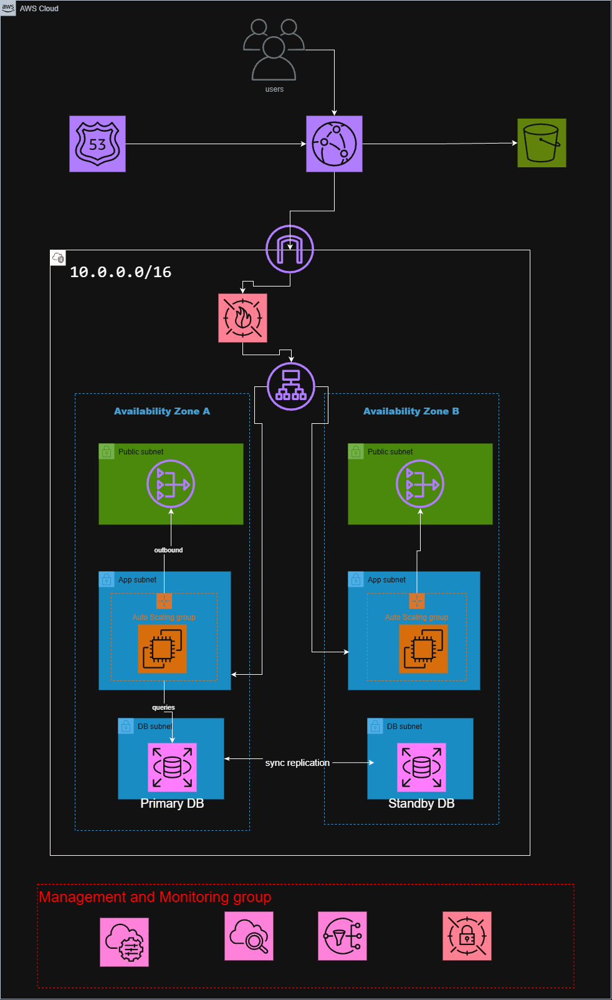
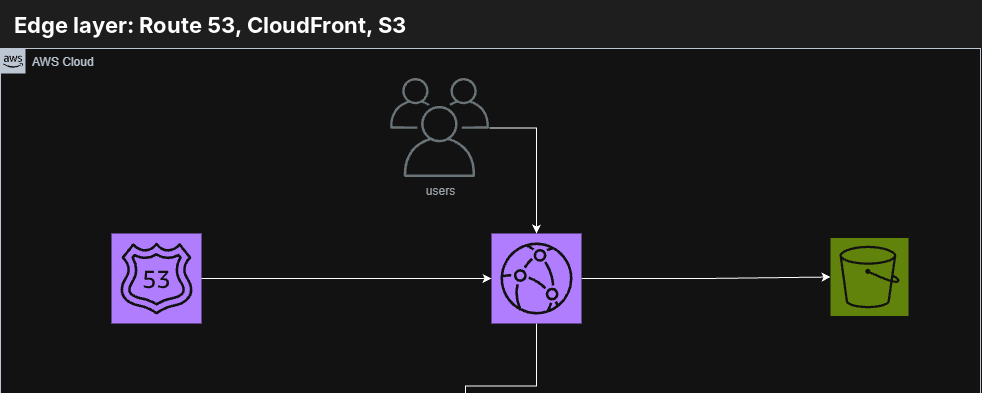
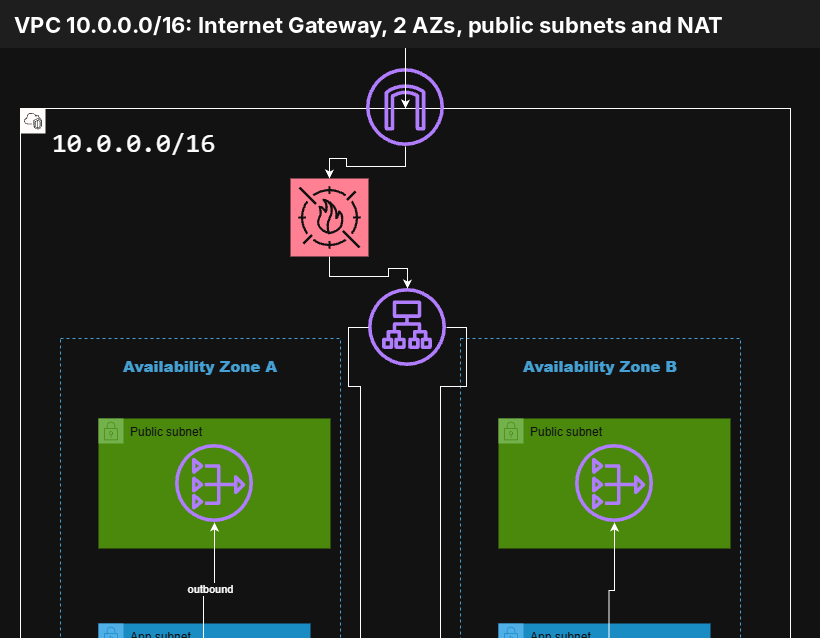
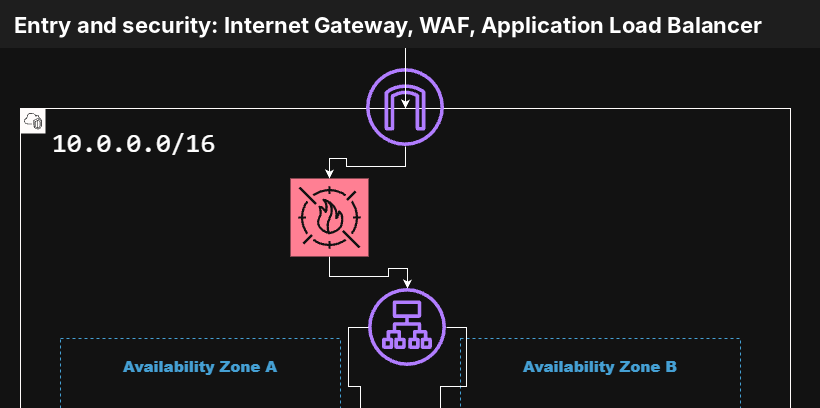
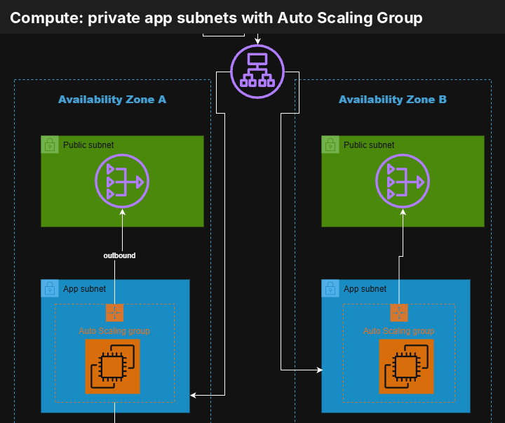
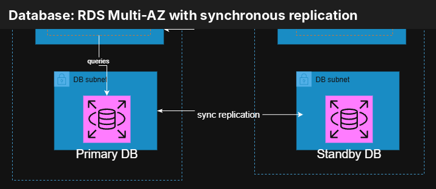
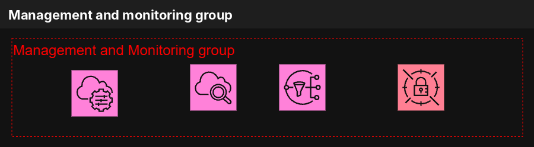

# Scalable Web Application with ALB and Auto Scaling

A production-style, highly available web application on AWS, built with **EC2 Auto Scaling behind an Application Load Balancer**, fronted by **CloudFront and WAF**, with a **Multi-AZ RDS** database. All infrastructure is defined as code with **Terraform**.

> Project 1 of the *AWS 2: Becoming a Solutions Architect* path (Manara). Architecture type: EC2-based.

## Table of Contents

- [Solution Overview](#solution-overview)
- [Architecture Diagram](#architecture-diagram)
- [Architecture by Layer](#architecture-by-layer)
- [Key AWS Services](#key-aws-services)
- [Design Decisions](#design-decisions)
- [Well-Architected Alignment](#well-architected-alignment)
- [Repository Structure](#repository-structure)
- [Deploy with Terraform](#deploy-with-terraform)
- [Terraform Variables](#terraform-variables)
- [Verify the Deployment](#verify-the-deployment)
- [Cost Notice and Clean Up](#cost-notice-and-clean-up)
- [Learning Outcomes](#learning-outcomes)
- [License](#license)

## Solution Overview

Users reach the application through **Amazon CloudFront**. Static assets under `/static/*` are cached at the edge and served from a private **S3** bucket. Everything else is forwarded to an **Application Load Balancer** protected by **AWS WAF**. The ALB spreads traffic across an **Auto Scaling group** of EC2 instances that run in **private subnets** in two Availability Zones. The instances talk to an **RDS Multi-AZ** database in isolated DB subnets. Administrators open shells through **Systems Manager Session Manager**, so there is no bastion host and no SSH port. **CloudWatch** and **SNS** provide dashboards, alarms and notifications.

## Architecture Diagram



Request flow:

1. A user resolves the domain through **Route 53** and connects to **CloudFront**.
2. `/static/*` is answered from the cache or from **S3** (Origin Access Control, bucket is private).
3. All other requests go to the VPC through the **Internet Gateway**, pass **WAF**, and reach the **ALB**.
4. The ALB forwards to healthy EC2 instances in the **app subnets** of both AZs.
5. Instances query the **primary RDS instance**, which replicates synchronously to the **standby** in the other AZ.
6. Instances reach the internet (updates, SSM) only through the **NAT Gateway** of their own AZ.

## Architecture by Layer

### 1. Edge: Route 53, CloudFront, S3



- CloudFront has two origins: the ALB (dynamic, caching disabled) and S3 (static, caching enabled).
- The S3 bucket blocks all public access. Only this CloudFront distribution can read it, through Origin Access Control.
- Route 53 has a health check on `/health` and an optional alias record for a custom domain.

Terraform: [`terraform/edge.tf`](terraform/edge.tf)

### 2. Network: VPC, subnets, NAT



| Tier | AZ A | AZ B | Route to internet |
|------|------|------|-------------------|
| Public (ALB, NAT) | 10.0.0.0/24 | 10.0.1.0/24 | Internet Gateway |
| App (EC2) | 10.0.10.0/24 | 10.0.11.0/24 | NAT Gateway in the same AZ |
| DB (RDS) | 10.0.20.0/24 | 10.0.21.0/24 | None |

One NAT Gateway per AZ means an AZ failure does not cut outbound access for the other AZ. NACLs add a stateless layer on top of the Security Groups.

Terraform: [`terraform/vpc.tf`](terraform/vpc.tf), [`terraform/security_groups.tf`](terraform/security_groups.tf)

### 3. Entry and security: WAF and ALB



- WAF web ACL on the ALB with AWS managed rule groups (Common, Known Bad Inputs, SQL injection) and a per-IP rate limit.
- The ALB Security Group accepts traffic only from CloudFront (AWS managed prefix list), so the ALB cannot be hit directly.
- Target group health check on `/health`. A listener rule returns `403` for `/admin*`.

Terraform: [`terraform/alb.tf`](terraform/alb.tf), [`terraform/waf.tf`](terraform/waf.tf)

### 4. Compute: EC2 and Auto Scaling



- Launch Template: Amazon Linux 2023, IMDSv2 required, encrypted gp3 volume, instance profile for Session Manager.
- Auto Scaling group: min 2, desired 2, max 6, spread over both app subnets, ELB health checks.
- Scaling policies: target tracking on average CPU (50%), target tracking on ALB requests per target, and a step scaling policy driven by a CPU alarm (80%).
- The instance Security Group allows HTTP only from the ALB. There is no SSH rule.

Terraform: [`terraform/compute.tf`](terraform/compute.tf), [`terraform/user_data.sh.tpl`](terraform/user_data.sh.tpl)

### 5. Database: RDS Multi-AZ



- MySQL 8.0 (default) or PostgreSQL 16, with a standby in the second AZ and automatic failover.
- Encrypted storage, 7-day automated backups, not publicly accessible.
- Master credentials are generated by RDS and stored in AWS Secrets Manager. The instance role can read that secret.
- Only the app Security Group can reach the database port.

Terraform: [`terraform/rds.tf`](terraform/rds.tf)

### 6. Management and monitoring



- **Systems Manager Session Manager** for shell access without a bastion.
- **CloudWatch** dashboard (ALB, targets, ASG, RDS, WAF) and alarms (5xx, unhealthy targets, CPU, storage).
- **SNS** topic that emails the alerts.
- **Secrets Manager** for database credentials.

Terraform: [`terraform/monitoring.tf`](terraform/monitoring.tf)

## Key AWS Services

| Service | Role in this project |
|---------|----------------------|
| VPC | Public, app and DB subnets, route tables, NAT Gateways, Security Groups, NACLs |
| EC2 + Auto Scaling | Launch Template, target tracking and step scaling policies |
| ALB + WAF | Layer 7 routing, OWASP-oriented managed rules, rate limiting |
| CloudFront | Edge caching for static assets, single public entry point |
| S3 | Private bucket for static assets |
| RDS Multi-AZ | MySQL or PostgreSQL with automated failover |
| Route 53 | Health check and optional alias record |
| Systems Manager | Session Manager, bastion-free access |
| CloudWatch + SNS | Dashboard, alarms, email notifications |
| Secrets Manager | Database credentials |

## Design Decisions

- **Private compute and database.** Instances have no public IP. The only way in is the ALB, and the only way to the database is from the app tier.
- **CloudFront in front of the ALB.** One public entry point, edge caching for static files, and the ALB Security Group is locked to CloudFront.
- **Security Group references instead of CIDRs** between tiers, so rules follow the instances as they scale.
- **One NAT Gateway per AZ.** Higher cost than a shared NAT, but no cross-AZ dependency for outbound traffic.
- **Two target tracking policies plus step scaling.** Target tracking keeps steady-state load balanced. Step scaling reacts faster to sharp CPU spikes.
- **IMDSv2 only and encrypted volumes** to reduce credential theft and data exposure risks.
- **No SSH.** Session Manager gives IAM-controlled, auditable access.

## Well-Architected Alignment

| Pillar | How it is addressed |
|--------|---------------------|
| Operational excellence | Infrastructure as code, CloudWatch dashboard, alarms, SNS alerts |
| Security | Private subnets, tiered Security Groups, NACLs, WAF, IMDSv2, encryption, Secrets Manager, no SSH |
| Reliability | Two AZs, Auto Scaling with ELB health checks, RDS Multi-AZ failover, one NAT per AZ, backups |
| Performance efficiency | CloudFront caching, scaling on CPU and requests per target |
| Cost optimization | Right-sized defaults (t3.micro), scale in when idle, price class 100 on CloudFront |
| Sustainability | Elastic capacity instead of fixed over-provisioning |

## Repository Structure

```
.
├── README.md
├── LICENSE
├── CHANGELOG.md
├── .gitignore
├── architecture/
│   ├── 00-full-topology.png
│   ├── 01-edge-route53-cloudfront-s3.png
│   ├── 02-vpc-network-layout.png
│   ├── 03-security-waf-alb.png
│   ├── 04-compute-asg.png
│   ├── 05-database-rds-multi-az.png
│   └── 06-management-monitoring.png
└── terraform/
    ├── versions.tf
    ├── variables.tf
    ├── main.tf
    ├── vpc.tf
    ├── security_groups.tf
    ├── alb.tf
    ├── waf.tf
    ├── compute.tf
    ├── user_data.sh.tpl
    ├── rds.tf
    ├── edge.tf
    ├── monitoring.tf
    ├── outputs.tf
    └── terraform.tfvars.example
```

## Deploy with Terraform

Prerequisites: [Terraform](https://developer.hashicorp.com/terraform/install) 1.5 or later, the [AWS CLI](https://aws.amazon.com/cli/) configured with credentials that can create the resources above.

```bash
git clone <this-repo-url>
cd <repo-folder>/terraform

cp terraform.tfvars.example terraform.tfvars   # edit the values

terraform init
terraform validate
terraform plan
terraform apply
```

Creation takes roughly 15 to 25 minutes, mostly for the Multi-AZ database and the CloudFront distribution.

If you set `alert_email`, confirm the subscription email from AWS, otherwise alarms will not reach you.

### Optional custom domain

Set `domain_name`, `hosted_zone_id` and `acm_certificate_arn` (the certificate must be in `us-east-1`). Terraform then adds the domain to CloudFront and creates the Route 53 alias record.

## Terraform Variables

| Name | Default | Description |
|------|---------|-------------|
| `aws_region` | `us-east-1` | Region to deploy into |
| `project_name` | `scalable-web` | Prefix for resource names |
| `environment` | `dev` | Environment name |
| `vpc_cidr` | `10.0.0.0/16` | VPC CIDR |
| `instance_type` | `t3.micro` | EC2 instance type |
| `asg_min_size` / `asg_desired_capacity` / `asg_max_size` | `2` / `2` / `6` | Auto Scaling limits |
| `cpu_target_value` | `50` | CPU target for target tracking (%) |
| `requests_per_target` | `500` | ALB requests per instance target |
| `db_engine` | `mysql` | `mysql` or `postgres` |
| `db_instance_class` | `db.t3.micro` | RDS instance class |
| `db_allocated_storage` | `20` | RDS storage (GiB) |
| `db_name` / `db_username` | `appdb` / `dbadmin` | Initial database and master user |
| `db_deletion_protection` | `false` | Set `true` for production |
| `domain_name` / `hosted_zone_id` / `acm_certificate_arn` | empty | Optional custom domain |
| `alert_email` | empty | Email for SNS alerts |

## Verify the Deployment

1. Open `https://<cloudfront_domain_name>` (from `terraform output`). The page shows the instance ID and AZ that served the request. Refresh several times to see both AZs.
2. Open `https://<cloudfront_domain_name>/static/style.css` to confirm S3 through CloudFront works.
3. Open `/admin` to see the ALB rule return `403`.
4. In **EC2 > Target Groups**, confirm all targets are healthy.
5. Connect to an instance without SSH:
   ```bash
   aws ssm start-session --target <instance-id> --region <region>
   ```
6. Test failover: terminate one instance (the ASG replaces it) and, in **RDS**, reboot with failover to see the standby take over.
7. Generate load and watch the ASG scale out on the CloudWatch dashboard (`dashboard_url` output).

## Cost Notice and Clean Up

This stack is **not free-tier friendly**. Two NAT Gateways, the ALB, a Multi-AZ RDS instance and WAF all bill by the hour. Destroy everything when you finish testing:

```bash
cd terraform
terraform destroy
```

## Learning Outcomes

- Design a VPC with correct subnets, route tables and NAT Gateway configuration
- Build a highly available architecture across multiple Availability Zones
- Configure ALB listener rules and target group health checks
- Implement Auto Scaling with target tracking and step scaling policies
- Secure an application with WAF, Security Groups and private subnets
- Use Systems Manager Session Manager as a bastion-free access alternative

## License

Released under the [MIT License](LICENSE).
